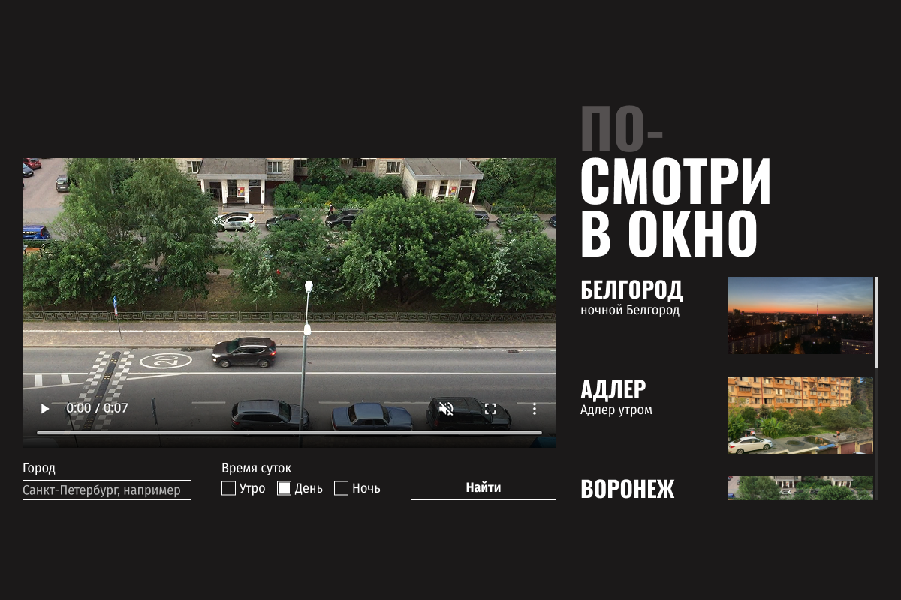

# Проектная работа «Посмотри в окно»

## Цель проекта
Стать связующим звеном между логикой (JS) и дизайном (UI).
Необходимо внедрить визуальную составляющую, строго следуя макету,
не нарушая при этом функциональность: поиск, переключение видео,
динамическую подгрузку карточек через <template> и отображение состояний (загрузка, ошибка).

## Скриншот макета

## [Ссылка на макет &rarr;](https://www.figma.com/design/ApJjZAA3pBv2tCZM9E2ul2/2-спринт.-Посмотри-в-окно?node-id=0-1&p=f&clckid=4864540c)
## [Ссылка на сайт проектной работы &rarr;]()